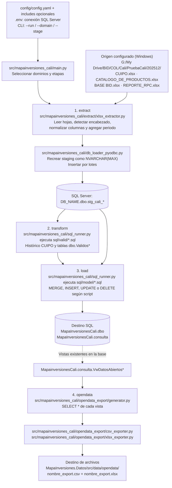
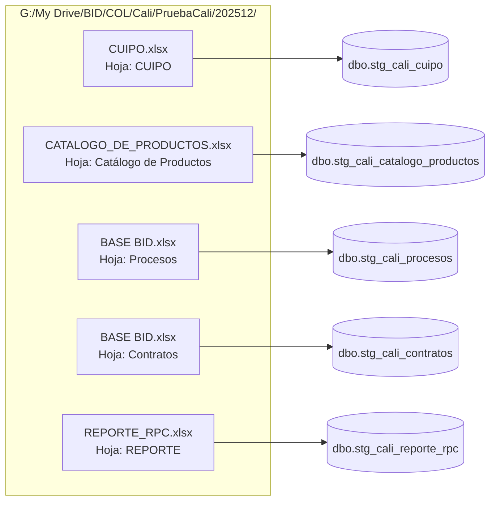
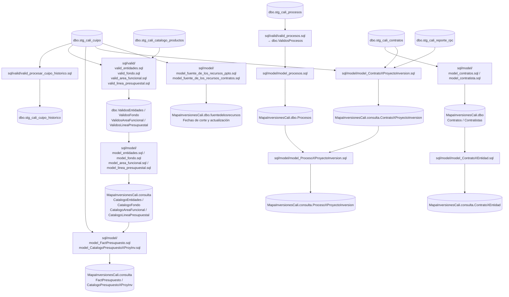
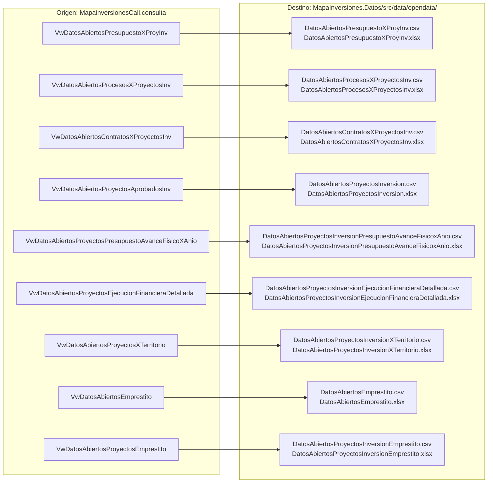

# ETL MapaInversiones Cali — PaQueVeas

Pipeline ELT en Python para actualizar los datos de la plataforma [PaQueVeas Cali](https://paqueveas.cali.gov.co).

Actualiza:
- Presupuesto de Inversión (CUIPO)
- Proyectos de Inversión
- Procesos y Contratos (SECOP II)
- Exportación a datos abiertos (CSV/XLSX)

---

## 1. Requisitos previos

- Python 3.12
- ODBC Driver 17 o 18 para SQL Server ([descargar](https://learn.microsoft.com/en-us/sql/connect/odbc/download-odbc-driver-for-sql-server))
- Acceso a la base de datos SQL Server (staging y modelo final)

---

## 2. Instalación

```bash
# Crear entorno virtual
python -m venv .venv

# Activar entorno virtual
# Linux/macOS:
source .venv/bin/activate
# Windows (PowerShell):
.venv\Scripts\Activate.ps1

# Instalar dependencias
pip install -r requirements.lock
pip install --no-deps .
```

---

## 3. Configuración de credenciales

Copiar el archivo de ejemplo y completar con los datos del entorno:

```bash
cp .env.example .env
```

Editar `.env`:

```
DB_SERVER=<servidor SQL Server>
DB_NAME=<base de datos staging, ej: PISGRSTG_Cali>
DB_USER=<usuario SQL>
DB_PASSWORD=<contraseña>
```

> **El archivo `.env` nunca se versiona.** Está en `.gitignore`.

---

## 4. Preparar archivos de entrada

Los archivos Excel de cada período deben colocarse en `data/AAAAMM/` (esta carpeta no está en el repositorio):

```
data/
└── 202601/
    ├── CUIPO.xlsx
    ├── CATALOGO_DE_PRODUCTOS.xlsx
    ├── BASE BID.xlsx
    └── REPORTE_RPC.xlsx
```

Luego actualizar en `config/config.yaml` las rutas `path` y el campo `periodo` de cada `extract_sources` con el período nuevo.

---

## 5. Ejecución

```bash
# Ver todos los perfiles disponibles
python -m mapainversiones_cali.main --list-runs

# Ejecutar un dominio completo (extract + transform + load + opendata)
python -m mapainversiones_cali.main --run presupuesto_full
python -m mapainversiones_cali.main --run procesos_full
python -m mapainversiones_cali.main --run contratos_full

# Solo exportar datos abiertos (sin reprocesar staging)
python -m mapainversiones_cali.main --run opendata_full

# Ejecución manual por dominio y etapa
python -m mapainversiones_cali.main --domain presupuesto --stage extract
python -m mapainversiones_cali.main --domain contratos --stage load
python -m mapainversiones_cali.main --domain procesos,contratos --stage extract,load
```

---

## 6. Flujo del pipeline

Los diagramas describen el código y la configuración actual de [config/config.yaml](config/config.yaml).
Las rutas relativas se resuelven desde el directorio de ejecución; ejecutar desde
`MapaInversiones.Datos/`. Los archivos de entrada son externos al repositorio.

### Orquestación y carpetas



Se ejecutan las etapas seleccionadas en el orden `extract → transform → load → opendata`,
y los elementos de cada etapa en el orden del YAML. Los perfiles pueden omitir etapas;
`opendata_full` consulta las vistas existentes sin volver a cargar Excel.
Una excepción detiene el pipeline; cada script SQL tiene su propia transacción,
sin rollback global de las etapas anteriores.

La configuración actual usa `periodo: "202512"` y rutas absolutas de Windows.
En Windows esas rutas prevalecen sobre `base_dir: "data"`. En Linux deben adaptarse:
por ejemplo, `base_dir: "data"` y `path: "202512/CUIPO.xlsx"` para leer
`MapaInversiones.Datos/data/202512/CUIPO.xlsx`. El campo `periodo` también debe actualizarse.

### Archivos y hojas de origen → tablas staging

Todas estas tablas pertenecen a la base indicada por `DB_NAME` (habitualmente
`PISGRSTG_Cali`). Las flechas pasan por el extractor XLSX y el cargador anteriores.



Si no se encuentran archivos o no hay filas, el cargador omite la carga y conserva
la tabla staging anterior. Cuando hay datos, elimina y recrea la tabla.

### Transformaciones y destinos SQL

Los nombres de scripts de cada nodo son archivos de la carpeta indicada.
Este diagrama resume rutas de datos; el orden de ejecución lo define `config/config.yaml`.



Los dominios dependen de datos previamente existentes: los scripts también consultan
`MapaInversionesCali.dbo.Proyecto`, catálogos del modelo final,
`PISGRSTG_Cali.dbo.EquivalenciaEntidades`, `dbo.ProcesosSECOP_II_Total`,
`dbo.VwProcesosAdicionalesDesdeContratos` y `dbo.VwProcesosConFechaPreviaFirmaContrato`.
No se crean ni extraen todos estos objetos en el pipeline configurado.
En particular, contratos necesita staging de CUIPO y REPORTE RPC aunque su perfil
solo extraiga CONTRATOS. La validación de líneas presupuestales consulta catálogos
existentes antes de la etapa `load`.

### Vistas de origen → archivos de destino

Cada flecha genera **dos archivos** en `MapaInversiones.Datos/src/data/opendata/`:
uno `.csv` (UTF-8 con BOM) y otro `.xlsx`. El exportador crea la carpeta si falta y
sobrescribe los archivos del mismo nombre. Una vista vacía no genera archivos
ni elimina exportaciones anteriores. Las vistas deben existir previamente;
el pipeline solo las consulta.



---

## 7. Configuración avanzada (`config/config.yaml`)

El archivo `config/config.yaml` controla todo el pipeline sin tocar el código:

- **`extract_sources`**: fuentes Excel → tablas staging
- **`transform_models`**: scripts SQL `sql/valid/` (staging → válidos)
- **`load_models`**: scripts SQL `sql/model/` (válidos → modelo final)
- **`opendata_exports`**: vistas a exportar como CSV/XLSX
- **`domains`**: agrupa items por dominio de negocio
- **`runs`**: perfiles de ejecución reutilizables

### Includes (configuración modular)

Se pueden componer varios YAML desde uno principal:

```yaml
includes:
  - config/base.yaml
  - config/domains/presupuesto.yaml
```

---

## 8. Estructura del repositorio

```
├── src/
│   ├── main.py                  # Orquestador principal
│   ├── db_loader_pyodbc.py      # Cargador usado por main.py (SQL Server)
│   ├── sql_runner.py            # Ejecuta scripts SQL
│   ├── extract/                 # Extractores (xlsx, csv, api, adls)
│   └── opendata_export/         # Exportadores CSV/XLSX
├── sql/
│   ├── valid/                   # Scripts transform (staging → válidos)
│   └── model/                   # Scripts load (válidos → modelo final)
├── config/config.yaml                  # Configuración del pipeline
├── requirements.txt
├── .env.example                 # Plantilla de credenciales
└── Dockerfile
```
